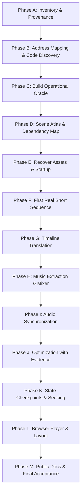

# DOS Demo Migration Plan: Master Recipe

This plan outlines the battle-tested, phase-by-phase methodology for porting a 1990s DOS demo or intro to a faithful, high-performance modern JavaScript and Web Audio deliverable.

---

## 1. Core Principles

1. **Faithful Reverse-Engineering, Not Visual Simulation**:
   The original executable, disassembly, and runtime captures are authoritative specifications. We do not re-implement effects based on subjective visual guesses.
2. **Pure Live JavaScript Rendering**:
   Every displayed frame is computed live by the translated JavaScript code running on Canvas 2D or WebGL. No pre-rendered video or cached screenshot sequences may masquerade as live rendering.
3. **Live Native Music Replay**:
   Translate and verify original replay/sequencing/mixing/synthesis/device-control code with original sound data. Do not use a module-player library, replacement synth, or recording. Tracker formats are only examples; support verified silence and original hardware behavior as applicable.
4. **Offline Differential Validation**:
   Correctness is proven by executing original machine code in an offline CPU emulator (Unicorn) on captured memory states, running the translated JavaScript on the same inputs, and verifying that registers, flags, memory writes, and framebuffers match.
5. **Fast Seeking via Checkpoints**:
   Start with deterministic replay seeking. Add complete-state checkpoints only when measured replay cost warrants them, using production-specific spacing and tested state restoration. Do not promise universal size or instant latency.
6. **Zero-Dependency Standalone Deliverable**:
   The final player uses standard ES Modules, runs in any modern browser, requires zero npm packages, and can be hosted statically on GitHub Pages or run locally with a double-click launcher.

---

## 2. The 13 Migration Phases

### Phase A — Inventory and Provenance
- Hash the original executable (`DEMO.EXE`) and companion files. Record the human-supplied debugger text with CS and nearby disassembly.
- Prepare the first Automatic Capture profile from `docs/templates/autocapture-config.template.json`: periodic 1–2-second snapshots, no address stop event or instruction trace. Run `python tools/oracle/validate_capture_profile.py --purpose timeline autocapture-config.json` and require PASS. The human runs DOSBox-X and provides `oracle/extract/<session>/`.
- Build the SQLite disassembly index using `asm_index.py` when a listing is available. Verify its source hash and key instructions against captured bytes.
- Run `inventory.py` across all capture manifests to verify asset sizes, hashes, and provenance.
- Inventory elapsed times, CPU modes, selector bases, and capture quality warnings.

### Phase B — Address Mapping and Code Discovery
- Reconcile the four coordinate spaces:
  1. Capture memory file offset.
  2. Segment selector offset (CS:EIP, DS:[offset], SS:ESP).
  3. Guest linear address (`segment.base + offset`).
  4. IDA Pro disassembly addresses.
- Verify byte sequences across multiple independent code/data locations.
- Map segment registers: check if CS, DS, ES, SS share a flat base and whether FS or GS point to specialized tables (e.g. BIOS data, zero-base low memory).
- Document all mappings in `docs/address-map.md`.

### Phase C — Build the Operational Oracle
- Set up offline Unicorn execution harness (`unicorn_runner.py`).
- Select a small leaf routine with clear input/output bounds (e.g. a vector math or buffer clear routine).
- Run the routine in Unicorn from a captured memory checkpoint.
- Verify all required input ranges are available and use real demo input from captures or verified original-file bytes. Record initial-state provenance; resume a mid-routine checkpoint at its captured instruction unless entry reconstruction is justified. Synthetic fixtures supplement this comparison and do not complete the real-input milestone. If an earlier run's memory was undersized, correct the full start-to-end timeline (normally 8 MiB at every 1–2-second snapshot) and analyze it offline. Live routine-entry/return pairs are not prerequisites; targeted capture is exceptional after an adequately sized full run and offline analysis demonstrably cannot answer a specific question, or at the human's explicit request.
- Implement the identical routine in JavaScript (`DemoMachine`).
- Use an explicit comparison contract with `differential_compare.py --contract`; missing state or unsuccessful endpoints are insufficient evidence. Expand tests across real checkpoints and into intervals, scenes, transitions/endings, and actual browser canvas checks. See `docs/guides/validation-ladder.md`.
- Inject a deliberate mismatch to verify that the comparison tool catches discrepancies.

### Phase D — Scene Atlas and Dependency Map
- Generate a visual scene contact sheet from capture screenshots using `scene_atlas.py`.
- Calculate deltas from decoded RGB pixels, never compressed image bytes. Treat large differences and resolution changes as candidate transition windows; motion and fades can also trigger them. Ask the human to accept or correct visual phases before promoting them to milestones.
- Build a provisional scene ledger (`docs/scene-ledger.md`): scene IDs, time intervals, candidate entry points, and visual characteristics.
- Identify shared rendering kernels: 3D perspective transforms, raster span drawers, texture samplers, palette fades, and blitters.

### Phase E — Recover Original Assets and Initialization
- Locate embedded assets: 3D meshes, texture bitplanes, palette color tables, sine lookup tables, font bitmaps, and music module files.
- Document whether assets are stored raw, compressed, or generated algorithmically at startup.
- Extract native assets into `oracle/assets/` and record their byte lengths and SHA-256 hashes.
- Write decoders/unpackers in JavaScript to reconstruct runtime assets from raw binary buffers.

### Phase F — The First Real Short Sequence
- Select the earliest tractable graphics scene.
- Translate its setup and drawing routines into JavaScript.
- Build a minimal HTML viewer and render the first continuous frame.
- Validate the rendered pixel framebuffer and palette against the capture reference.
- Extend execution frame-by-frame across the first scene transition.

### Phase G — Translation Across the Timeline
- Default to the full visual sequence before audible playback. The human may choose music first; record that preference and complete both milestones before shipping. Sound is not a prerequisite for this visual phase.
- Use a replaceable simulation clock based on recovered timing. Preserve any tracker-position or music-event control data needed by visuals without requiring the full audio mixer first; integrate the audio clock later and recheck the full timeline.
- Translate remaining scenes in chronological order:
  1. Map routine dependencies.
  2. Translate scene state initialization.
  3. Validate core math and rendering kernels.
  4. Validate full-frame output.
  5. Validate cross-scene transition logic (palette fades, buffer ownership swaps, timer triggers).
- Maintain continuity across scenes without resetting to unrelated emulator snapshots.

### Phase H — Music Extraction and Replay
- Reverse-engineer the music player routine (e.g. Scream Tracker 3 S3M, FastTracker 2 XM, ProTracker MOD, or custom tracker).
- Extract song headers, order tables, patterns, instruments, and sample PCM data.
- Separate the tracker sequencer from the software audio mixer:
  - **Tracker**: Advances rows, orders, notes, volume envelopes, and effects (portamento, vibrato) on song tick timing.
  - **Mixer**: Advances sample playback fractional positions and mixes channel PCM into the output audio buffer.
- Implement in Web Audio using a dedicated Web Worker and `AudioWorkletProcessor`.
- Prove audio chunk invariance: filling 1024-sample chunks produces identical PCM to filling 4096-sample chunks.

### Phase I — Synchronization and Frame Scheduling
- Establish the audio master clock: audio playback time is the authoritative presentation clock.
- Decouple simulation rate, render FPS, and browser display refresh:
  - If a frame takes longer to render, simulation advances with elapsed audio time to avoid slowing down the song.
  - Never slow the music to accommodate slow rendering.
- Identify timing anchors: match distinct musical beats or snare hits with visual scene transitions.

### Phase J — Optimization with Evidence
- Profile scenes in browser developer tools and Node.js benchmarks.
- Focus optimizations on hot shared kernels:
  - Textured span rasterization.
  - Perspective projection and transformation loops.
  - Palette color lookups and compositing.
- Follow strict optimization protocol:
  1. Record baseline execution speed.
  2. Implement isolated optimization.
  3. Re-run differential verification: the optimized routine must produce 100% identical memory or pixel output.
  4. Perform paired A/B timing measurements. Revert noisy or negligible changes.

### Phase K — Checkpoints and Fast Navigation
- Measure reset-and-advance seeking before adding checkpoints. If needed, use a production-specific interval:
  - Diff memory or serialize the high-level state actually used by the translated algorithms.
  - Include every future-affecting palette, sound/device, FPU, timer, feedback, and other state; the memory helper does not infer them. Verify the exact baseline and compare restored progression with uninterrupted execution.
- When the user seeks:
  - Find the nearest valid preceding checkpoint at the measured production-specific spacing, or reset and replay if already fast enough.
  - Restore memory and state.
  - Compute simulation forward to the target timestamp.
  - Show a "Loading…" overlay until both graphics and audio are ready.

### Phase L — Browser Package and Layout
- Assemble the standalone shipping package in `player/`.
- Provide responsive, aspect-ratio-preserving canvas layout.
- Include gate splash screen with production credits, Pouët/GitHub links, and user-gesture Start button.
- Implement full playback controls: Pause, Stop, ±15s seeking, draggable scrubber, Fullscreen API, and "Stats for nerds" overlay (FPS, draw time, audio drift, tracker view).
- Include zero-dependency local launchers: `Start.cmd` / `Start.ps1` (PowerShell) and `server.mjs` (Node.js).

### Phase M — Explanations and Public Documentation
- Write the public project README:
  - Production credits and Pouët link.
  - Live browser demonstration link.
  - Key controls and local run instructions.
  - Technical reverse-engineering highlights.
- Create an "Effects Explained" page with interactive diagrams and mathematical formulas.
- Verify that no capture archives, raw disassembly, or development tools leak into the shipping player folder.

---

## 3. Risk Register

| Risk | Symptom | Countermeasure |
|---|---|---|
| Coordinate mismatch | Code fetches from data; byte discrepancies | Reconcile linear vs selector base before translating routines |
| Untrusted index | IDA misclassified data as code | Cross-reference instructions against raw runtime memory bytes |
| Floating-point drift | Accumulating numeric error across frames | Preserve exact x87 precision (24/53/64-bit), rounding modes, and CW |
| Hidden hardware polling | Replay hangs in infinite loop waiting for status bit | Identify VGA retrace or PIT timer polling; model minimal deterministic progression |
| Audio/visual desync | Music finishes while visuals lag behind | Drive graphics presentation from audio playback clock |
| Incomplete seek state | Seeking to a scene looks wrong or crashes | Checkpoint all future-affecting state: registers, dirty memory, palette, tracker voices |
| Slow rendering | Sub-20 FPS playback in browser | Lift span loops into typed-array bulk writes; optimize inner rasterizers with differential proofs |
